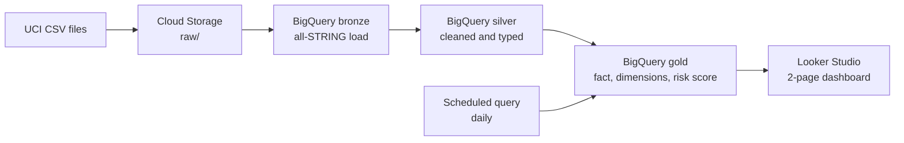

# Hospital Readmission Pipeline on GCP (Diabetes, 130 US Hospitals)

End-to-end data pipeline on Google Cloud: raw CSV files to BigQuery medallion layers (bronze, silver, gold) to a Looker Studio dashboard, with a rule-based readmission risk score.

**Live dashboard:** https://datastudio.google.com/reporting/dcb8ab60-c08e-4bac-9cfa-dcf49dd84eb6

## Architecture

## Dataset

UCI *Diabetes 130-US Hospitals for Years 1999-2008*: 101,766 patient encounters and 50 columns, plus an ID mapping file for admission type, discharge disposition, and admission source.

## Pipeline

| Layer | What happens |
|---|---|
| bronze | CSV files loaded as all-STRING. Autodetect failed on mixed-type diagnosis codes, so typing is deferred to silver. |
| silver | `?` replaced with NULL, types cast, `age_min` extracted from ranges like `[70-80)`, `readmitted_30d` flag, ICD-9 diagnosis grouping, duplicate removal, expired/hospice flag. |
| gold | Decoded dimension tables, `fact_encounters`, risk score and segment, `risk_summary`. |

**Key decision:** patients who died or were discharged to hospice (2,423) are excluded from readmission rates, because they cannot be readmitted. Eligible encounters: 99,343.

## Risk score (0 to 11 points)

| Factor | Points |
|---|---|
| Prior inpatient visits | 0 / 1 / 2-3 / 4+ gives 0 / 1 / 2 / 3 |
| Prior emergency visits | 0 / 1-2 / 3+ gives 0 / 1 / 2 |
| Days in hospital | up to 3 / 4-7 / 8+ gives 0 / 1 / 2 |
| Number of medications | up to 10 / 11-20 / 21+ gives 0 / 1 / 2 |
| Diagnoses count | 9 or more gives 1 |
| Age | 70 or older gives 1 |

Segments: **Low** = 0-2, **Medium** = 3-5, **High** = 6+.

## Results

| Segment | Encounters | 30-day readmission rate |
|---|---|---|
| Low | 38,350 | 7.38% |
| Medium | 48,789 | 12.51% |
| High | 12,204 | 19.53% |

Observed readmission rates rise steadily with the score, and the High segment is about 2.6x the Low segment. This is a rule-based stratification validated against observed outcomes, not a trained predictive model.

## Dashboard

## Tech stack

Google Cloud Storage, BigQuery (scheduled queries), SQL, Looker Studio.

## Repository contents

- `sql/silver_encounters.sql`: cleaning and typing
- `sql/gold_build.sql`: dimensions, fact table, risk score, summary
- `images/`: dashboard and BigQuery screenshots

## How to reproduce

1. Create a GCP project and a Cloud Storage bucket, then upload the CSV files to `raw/`.
2. Create BigQuery datasets `bronze`, `silver`, and `gold`.
3. Load `diabetic_data.csv` into `bronze.diabetic_data` with every column as STRING, and load the three ID lookup tables into bronze.
4. Run `sql/silver_encounters.sql`, then `sql/gold_build.sql`.
5. Connect Looker Studio to `gold.fact_encounters` and build the dashboard.
